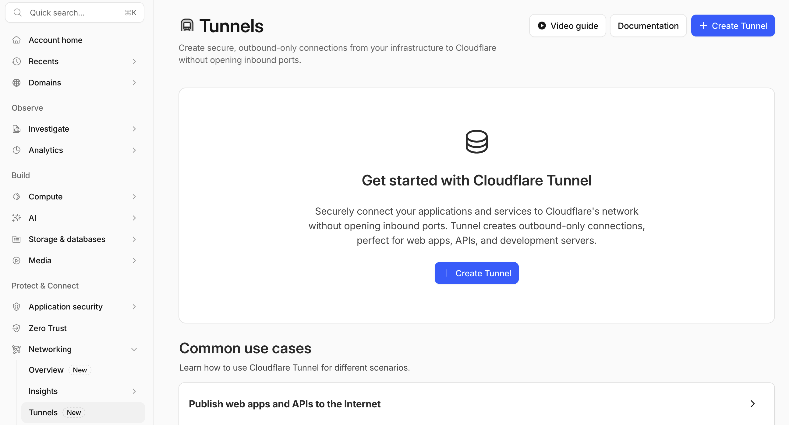
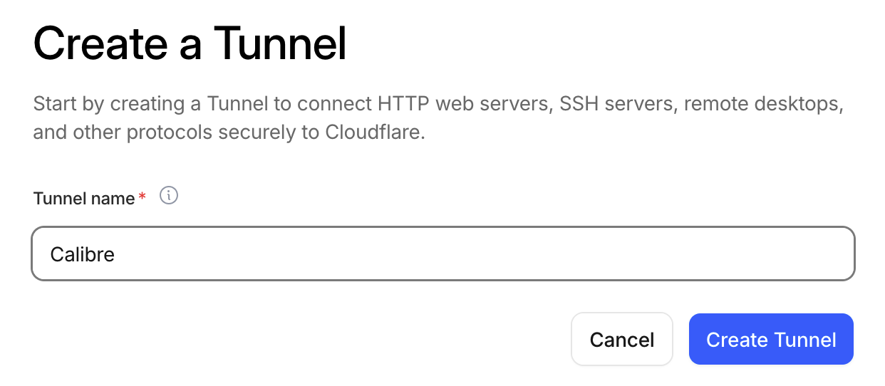
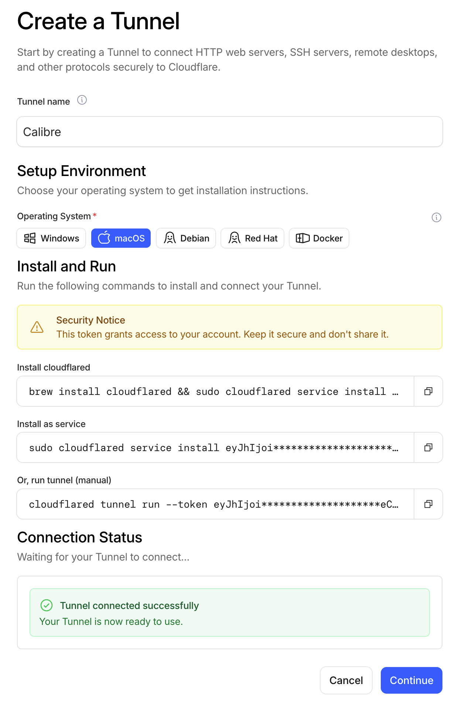

Calibre has a "Content Server" feature. User can visit its Content Server via http://localhost:8080 if Calibre is running with content server is turned on by default.
However, the content server is only accessible within the same WiFi network, meaning that you cannot read ebooks with mobile device outside home network.

Cloudflare Tunnel makes your Calibre Content Server accessible from anywhere by tunnelling a public domain traffic to the server that runs on your machine locally, if you have a custom domain.

[](https://mermaid.live/edit#pako:eNqFUTtPwzAQ_ivWLSwh5EGaxEMXmFnYUBbXvjYWiV0cGyhV_zvnECggJIZIvsf3yh1BWoXAYcKngEbirRY7J8bOdF5Ibx0LE7pY7YXzWuq9MJ5tnH35oy0HG9R2EA5_T0YhN9Y-xnb8Iufler3QcPasJ-1Z7_1-4ldXUgx64zAdD72dfCrt7GZZJthZhrPbu3smjPomrZizwWuzi6Bzm3CLCc4cCtnPcqQ2WNKLQrzJmixhNx_qFxNTuBVhoFjWeKQQpP78EXph-h5hHv4LpqQijrQhn1H0Z7IwU5E9xTAKTPP-mfQnGSQwohuFVnS_Y2cY68D3OGIHnJ6Lgw46c6JVEby9PxgJ3LuACdBf2vXAt2KYqAp7Jfzn8b-6dLsHa8dPCJXAj_AK_DLPiyat81WZNVVb1lUCB-BVnlZVXldl29ZNVtTl9SmBt5mgSFd1npfZqsjrrK2v2yKBnYvOFzdoFLobG4wnntM7NtTo6g)

### Assumptions
1. you own a domain `myhost.com` and it's managed by Cloudflare.
2. you are about to create a subdomain calibre.myhost.com for tunnelling public traffic.
3. the tunnel you are about to create is `Calibre`.

Sign in to the dashboard https://dash.cloudflare.com. Choose **Networking** > **Tunnel** at the left menu. Click **+ Create Tunnel**:


Name your tunnel (case-sensitive), then click **Create Tunnel**:


Follow the instruction to set up tunnel service on your machine. For me as a Mac user, I install cloudflared via homebrew:

```bash
brew install cloudflared
```

Then, you need `sudo` and type your password to install the service:

```
sudo cloudflared service install <the token>
```

If you want to run cloudflared manually (a foreground process):

```bash
cloudflared tunnel run --token <the token>
```



You should see a "Tunnel connected successfully" message if connection is established. Click **Continue**

Login to Cloudflare in cloudflared

```bash
❯ cloudflared tunnel login
A browser window should have opened at the following URL:

https://dash.cloudflare.com/argotunnel?aud=&callback=xxx

If the browser failed to open, please visit the URL above directly in your browser.
2026-06-28T19:44:10Z INF You have successfully logged in.
If you wish to copy your credentials to a server, they have been saved to:
/Users/<your-user-name>/.cloudflared/cert.pem
```

Find out the tunnel id:
```bash
❯ cloudflared tunnel list
You can obtain more detailed information for each tunnel with `cloudflared tunnel info <name/uuid>`
ID                                   NAME    CREATED              CONNECTIONS
<tunnel-uuid> Calibre 2026-06-28T19:32:41Z
```
You can see the CONNECTIONS is empty, meaning that this tunnel is not running yet.

Create a config file:
```
❯ sudo mkdir -p /etc/cloudflared
sudo touch /etc/cloudflared/config.yml
```

In the config.yml file:

```yml
tunnel: <tunnel-uuid>
credentials-file: /etc/cloudflared/<tunnel-uuid>.json

ingress:

  - hostname: https://calibre.myhost.com
    service: http://localhost:8080
  - service: http_status:404
```


Create the tunnel json file:
```bash
cloudflared tunnel token --cred-file ~/.cloudflared/<tunnel-uuid>.json Calibre
sudo cp ~/.cloudflared/<tunnel-uuid>.json /etc/cloudflared/
```

Restart the service:
```bash
sudo cloudflared service uninstall 
sudo cloudflared service install 
```

Modify the plist file `/Library/LaunchDaemons/com.cloudflare.cloudflared.plist`, add `tunnel` and `run` to the `ProgramArguments` array:

```xml
<?xml version="1.0" encoding="UTF-8"?>

<!DOCTYPE plist PUBLIC "-//Apple//DTD PLIST 1.0//EN" "http://www.apple.com/DTDs/PropertyList-1.0.dtd">

<plist version="1.0">
<dict>
	<key>Label</key>
	<string>com.cloudflare.cloudflared</string>
	<key>ProgramArguments</key>
		<array>
			<string>/opt/homebrew/bin/cloudflared</string>
			<string>tunnel</string>
			<string>run</string>
		</array>
	<key>RunAtLoad</key>
	<true/>
	<key>StandardOutPath</key>
	<string>/Library/Logs/com.cloudflare.cloudflared.out.log</string>
	<key>StandardErrorPath</key>
	<string>/Library/Logs/com.cloudflare.cloudflared.err.log</string>
	<key>KeepAlive</key>
	<dict>
		<key>SuccessfulExit</key>
		<false/>
	</dict>
	<key>ThrottleInterval</key>
	<integer>5</integer>
</dict>
</plist>
```


Add DNS record
click **"+ add route**:


choose **published application**:


fill in the subdomain (`calibre`) and service URL (`http://localhost:8080`)
You should see a "Route added successfully" message

Then, visit https://calibre.myhost.com and you should see Calibre's content server.